# SDL Graphics: examples

[Leer en español](README.md)

Example programs for the [`sdl-graphics`](../mvn-sdl-graphics/README.en.md) library
(BGI / `graphics.h` for Java 21 with SDL 3). It includes classic Turbo C programs ported
to the library.

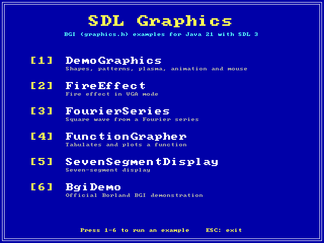

## Gallery

| | |
|:---:|:---:|
| 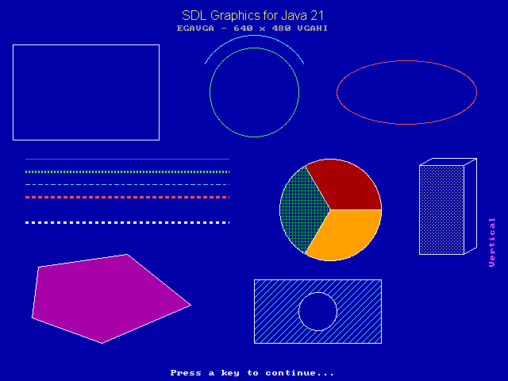<br>`DemoGraphics`: shapes, line styles and text | 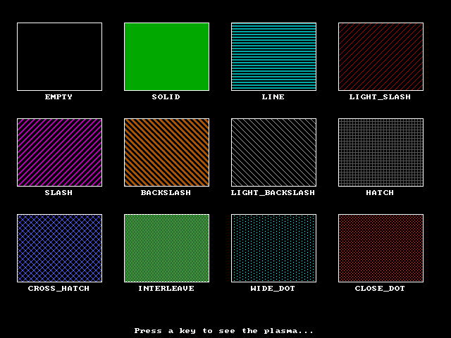<br>`DemoGraphics`: the 12 fill patterns |
| 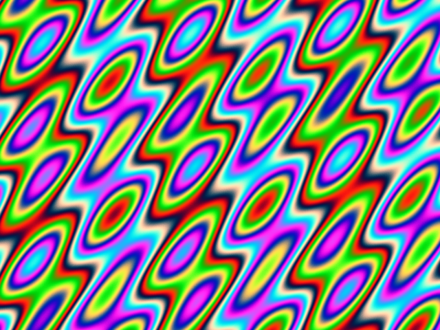<br>`DemoGraphics`: plasma with RGB colors | 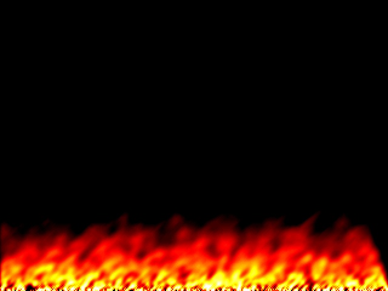<br>`FireEffect` (`FIRE.C`) |
| 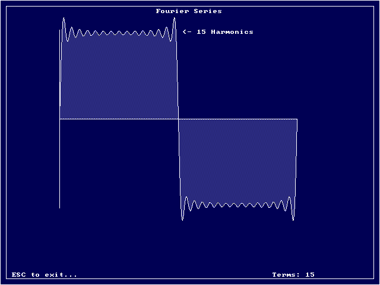<br>`FourierSeries` (`FOURIER.C`) with 15 harmonics | 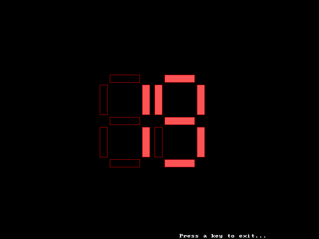<br>`SevenSegmentDisplay` (`DISPLAY.C`) |
| 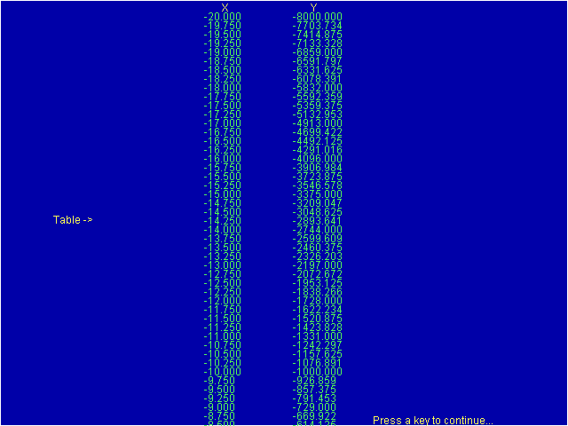<br>`FunctionGrapher` (`GRAFICA.C`): table | 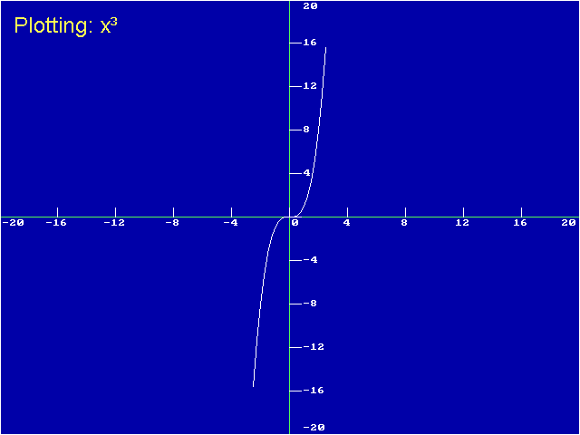<br>`FunctionGrapher`: plot with `Plot2D` |
| 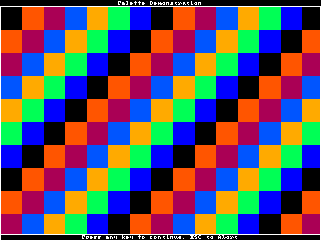<br>`BgiDemo` (`BGIDEMO.C`): palette | 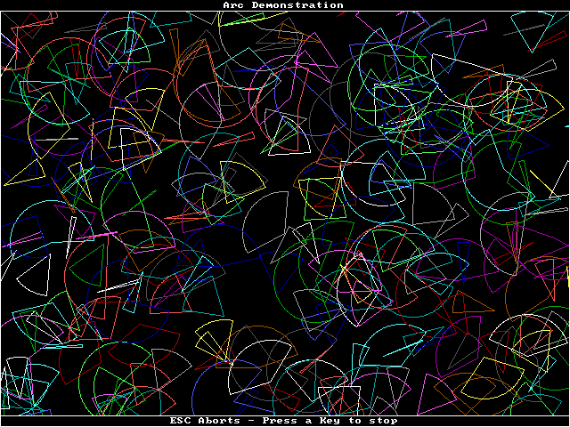<br>`BgiDemo`: arcs |
| 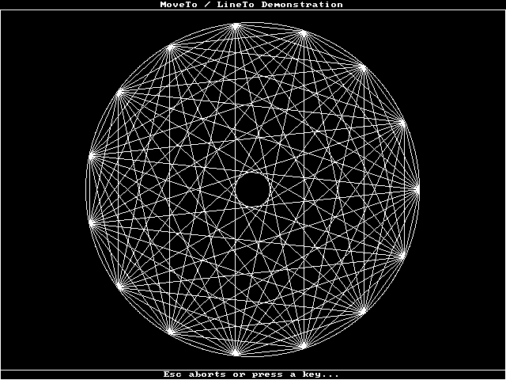<br>`BgiDemo`: `moveTo` / `lineTo` | |

The screenshots are generated without opening windows by a test that is normally disabled
(`screenshot.ExampleScreenshotsTest`). To regenerate them in `docs/images`:

```bash
mvn test -Dtest=ExampleScreenshotsTest -Dscreenshots=true
```

## Requirements

First install the library in the local Maven repository:

```bash
cd ../mvn-sdl-graphics
mvn clean install
```

The `sdl-graphics` dependency brings LWJGL, SDL3 and their native binaries; this project
does not need to declare them.

## Build and run

```bash
mvn clean package          # builds, tests the examples (windowless) and generates the fat jar
mvn compile exec:java      # opens the examples menu (com.juniverse.graphics.examples.Main)
```

### Examples menu

`Main` opens a window with the examples numbered 1 to 6:

1. `DemoGraphics`
2. `FireEffect`
3. `FourierSeries`
4. `FunctionGrapher`
5. `SevenSegmentDisplay`
6. `BgiDemo`

When a number is pressed, the menu closes and the example runs in its own window.
When the example finishes, the menu appears again. ESC exits the program. To add an
example to the menu, add it to the `Main.EXAMPLES` list.

The examples no longer call `System.exit`. When one ends with ESC or cannot start the
graphics mode, it closes its window and returns to the menu (internally it uses
`exception.ExampleAbortedException`). If an example fails, the error is logged and
execution also returns to the menu.

### Packages

```
com.juniverse.graphics.examples
├── Main         Examples menu
├── bgidemo      DemoGraphics (BgiDemo, DemoFrame and its demonstrations)
├── firedemo     (FireEffect)
├── mathdemo     Fourier and Grafica
├── dto          Records: Example (menu entry), PaletteBox
└── exception    ExampleAbortedException
```

### Fat jar

`mvn package` generates `target/mvn-sdl-graphics-examples-<version>-all.jar`, a **fat jar**
with the examples, the library, LWJGL, SLF4J and the SDL3 natives. To copy it to another
computer it is enough to have Java 21:

```bash
java -jar target/mvn-sdl-graphics-examples-1.0-0-all.jar        # opens the menu
java -cp target/mvn-sdl-graphics-examples-1.0-0-all.jar com.juniverse.graphics.examples.firedemo.FireEffect
```

* The fat jar includes the natives **of the operating system it is built on**. For another
  system: `mvn package -Dlwjgl.natives=natives-linux` (or `natives-macos`, `natives-macos-arm64`).
* On macOS: `java -XstartOnFirstThread -cp ...`. `exec:java` does not work on macOS because
  it reuses Maven's JVM.

## Log messages (SLF4J)

The examples' messages are logged with [SLF4J](https://www.slf4j.org/) instead of
`System.out`/`System.err`. The implementation is `slf4j-simple`, which writes to the console:

```
14:22:56.423 INFO Main - Running example BgiDemo
14:22:58.101 INFO BgiDemo - BgiDemo aborted with ESC
```

Log and exception messages, window titles and the texts displayed in them are in English.

The format and levels are configured in `src/main/resources/simplelogger.properties`.
For example, to also see debug messages (keys ignored in the menu,
number of Fourier terms, ...):

```properties
org.slf4j.simpleLogger.log.com.juniverse.graphics.examples=debug
```

To change the level without recompiling, use
`java -Dorg.slf4j.simpleLogger.defaultLogLevel=debug -jar ...`.

## Examples

| Original | Java class | What it does |
|----------|------------|--------------|
| — | `DemoGraphics` | Tour of the library: shapes, patterns, plasma, double-buffered animation and mouse drawing |
| `DISPLAY` | `SevenSegmentDisplay` | 7-segment display that counts from 00 to 19 (rectangles + `floodFill`) |
| `FOURIER` | `FourierSeries` | Asks for a number of terms and draws the square wave as a sum of harmonics; includes text input in graphics mode (`gscanfxy`/`ggets`) |
| `FIRE` | `FireEffect` | Mode 13h fire effect (320x200, 256 colors) using an in-memory buffer, RGB palette and `putImage` |
| `GRAFICA` | `Plot2D` | Mini library to plot in logical coordinates (logical window, axes, divisions, labels) |
| `GRAFICA` | `FunctionGrapher` | Tabulates a function and plots it with `Plot2D`; the function is changed in the `FUNCTION` and `FUNCTION_NAME` constants |
| `BGIDEMO` | `bgidemo.BgiDemo` | Borland's official demonstration: 20 screens with colors, palette, pixels, images, bars, arcs, pies, lines, fonts, fills and polygons |

To run each one:

```bash
mvn compile exec:java -Dexec.mainClass=com.juniverse.graphics.examples.mathdemo.SevenSegmentDisplay
mvn compile exec:java -Dexec.mainClass=com.juniverse.graphics.examples.mathdemo.FourierSeries
mvn compile exec:java -Dexec.mainClass=com.juniverse.graphics.examples.firedemo.FireEffect
mvn compile exec:java -Dexec.mainClass=com.juniverse.graphics.examples.mathdemo.FunctionGrapher
mvn compile exec:java -Dexec.mainClass=com.juniverse.graphics.examples.bgidemo.BgiDemo
```

### Differences from the originals

* **Maximizable window:** the ported examples use fixed coordinates, so they enable
  `setWindowScaling(ScalingMode.KEEP_ASPECT)`. When maximized, the whole drawing is enlarged
  keeping the aspect ratio.
* **`Grafica`:**
  - `Title` computed the screen position but wrote with the logical coordinates;
    here it uses the transformed position. `FunctionGrapher` places the title at the top
    left, away from the axes.
  - The axis numbers no longer overlap the ticks: the X axis ones go below the
    axis and the Y axis ones to the right of their tick. The 0 is written only once.
* **`BGIDemo`:**
  - The 20 demonstrations are grouped by topic in classes of the `bgidemo` package
    (`ColorDemos`, `BarDemos`, `TextDemos`, ...). They share `DemoFrame`, which contains
    `MainWindow`, `StatusLine`, `Pause` and `gprintf`.
  - `PaletteDemo`: on EGA/VGA, changing a palette entry instantly recolored
    the pixels; here the boxes of that color are repainted.
  - `PutPixelDemo`: the points are put and removed in batches with pauses. On a current
    machine the original finishes in less than one screen frame and only the black
    screen would be seen.
  - `CRTModeDemo`: there is no text mode, so the DOS console is simulated inside the
    window. `setGraphMode` reuses the same window.
  - `UserLineStyleDemo`: the original turned the bits off with `!` (logical negation) and cleared
    the pattern at once; here `~` is used, which was the intention.
  - `TextDump`:
    - Codes 0..255 are converted with `CodePage437`, so the same characters
      as in DOS are seen (Ç ü é ñ ¿ ░▒▓ │┤ ±≥≤ ...).
    - Each character is measured with the current font before writing it, so that the lines
      do not run off the window. The original measured with the previous font.
* **`Fourier`:** text input restores the exact background when erasing with Backspace
  (the original painted a hole with the background color) and shows a cursor.
* **`Fire`:**
  - The 6-bit VGA palette is converted to RGB.
  - The simulation is still 320x200, but it is displayed at double size and scaled when
    maximized.
  - Reads outside the screen, which in DOS read neighboring memory, use a margin
    of zeros.

## Tests

The tests open no windows: they use `FakePlatform`, which comes in the library's
`test-jar`.

| Test class | What it verifies |
|------------|------------------|
| `ExamplesSmokeTest` | Runs `BgiDemo` (all 20 screens) and `FunctionGrapher` completely by simulating keys; ESC ends `BgiDemo` without closing the application; the menu lists the 6 examples, returns the chosen one and exits with ESC |
| `Plot2DTest` | Format of the `Plot2D` axis labels |
| `FireSimulationTest` | `FireEffect` simulation: fire appears at the bottom and the top rows stay black |
