# SDL Graphics: ejemplos

Programas de ejemplo de la biblioteca [`sdl-graphics`](../mvn-sdl-graphics/README.md)
(BGI / `graphics.h` para Java 21 con SDL 3). Incluye programas clásicos de Turbo C portados
a la biblioteca.

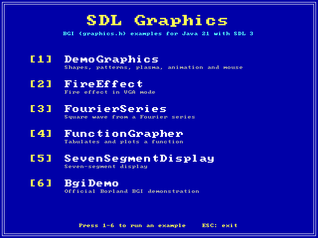

## Galería

| | |
|:---:|:---:|
| 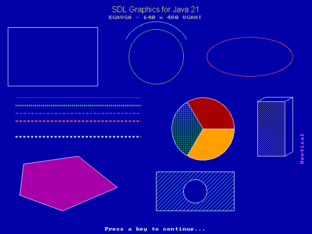<br>`DemoGraphics`: figuras, estilos de línea y texto | 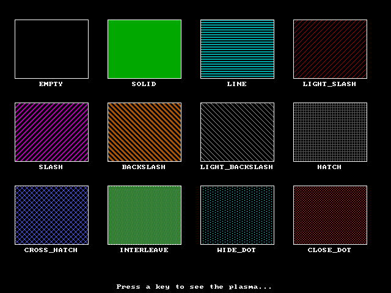<br>`DemoGraphics`: los 12 patrones de relleno |
| 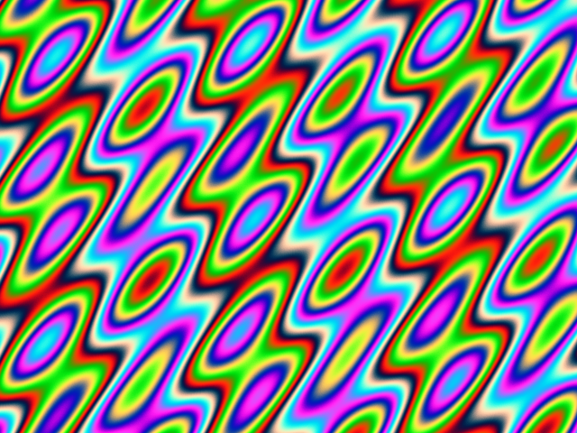<br>`DemoGraphics`: plasma con colores RGB | 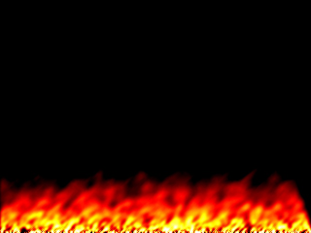<br>`FireEffect` (`FIRE.C`) |
| 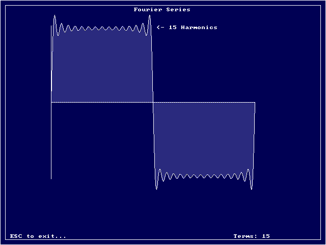<br>`FourierSeries` (`FOURIER.C`) con 15 armónicos | 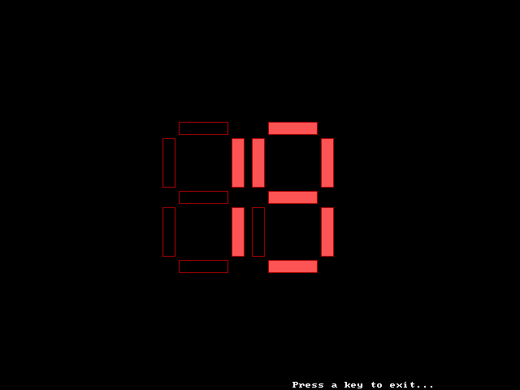<br>`SevenSegmentDisplay` (`DISPLAY.C`) |
| 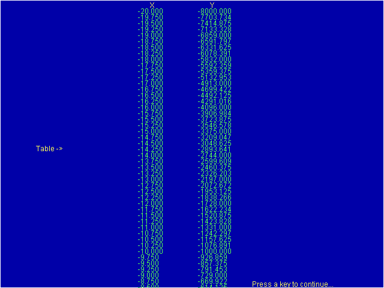<br>`FunctionGrapher` (`GRAFICA.C`): tabla | 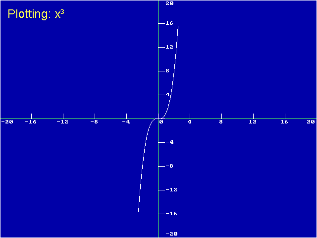<br>`FunctionGrapher`: gráfica con `Plot2D` |
| 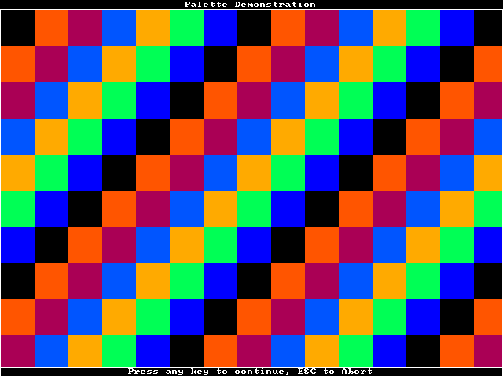<br>`BgiDemo` (`BGIDEMO.C`): paleta | 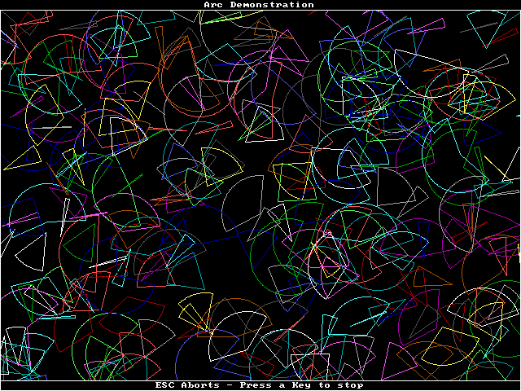<br>`BgiDemo`: arcos |
| 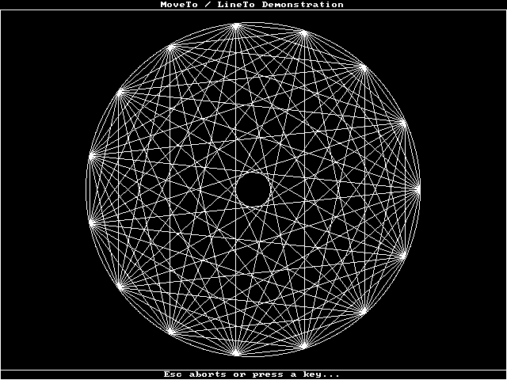<br>`BgiDemo`: `moveTo` / `lineTo` | |

Las capturas se generan sin abrir ventanas con una prueba que normalmente está desactivada
(`screenshot.ExampleScreenshotsTest`). Para regenerarlas en `docs/images`:

```bash
mvn test -Dtest=ExampleScreenshotsTest -Dscreenshots=true
```

## Requisitos

Primero instale la biblioteca en el repositorio local de Maven:

```bash
cd ../mvn-sdl-graphics
mvn clean install
```

La dependencia `sdl-graphics` trae LWJGL, SDL3 y sus binarios nativos; este proyecto no
necesita declararlos.

## Compilar y ejecutar

```bash
mvn clean package          # compila, prueba los ejemplos (sin ventanas) y genera el fat jar
mvn compile exec:java      # abre el menú de ejemplos (com.juniverse.graphics.examples.Main)
```

### Menú de ejemplos

`Main` abre una ventana con los ejemplos numerados del 1 al 6:

1. `DemoGraphics`
2. `FireEffect`
3. `FourierSeries`
4. `FunctionGrapher`
5. `SevenSegmentDisplay`
6. `BgiDemo`

Al presionar un número, el menú se cierra y el ejemplo se ejecuta en su propia ventana.
Al terminar el ejemplo, el menú vuelve a aparecer. ESC sale del programa. Para agregar un
ejemplo al menú, añádalo a la lista `Main.EXAMPLES`.

Los ejemplos ya no llaman a `System.exit`. Cuando uno termina con ESC o no puede iniciar el
modo gráfico, cierra su ventana y regresa al menú (internamente usa
`exception.ExampleAbortedException`). Si un ejemplo falla, el error se registra en el log y
también se vuelve al menú.

### Paquetes

```
com.juniverse.graphics.examples
├── Main         Menú de ejemplos
├── bgidemo      DemoGraphics (BgiDemo, DemoFrame y sus demostraciones)
├── firedemo     (FireEffect)
├── mathdemo     Fourier y Grafica
├── dto          Records: Example (entrada del menú), PaletteBox
└── exception    ExampleAbortedException
```

### Fat jar

`mvn package` genera `target/mvn-sdl-graphics-examples-<versión>-all.jar`, un **fat jar**
con los ejemplos, la biblioteca, LWJGL, SLF4J y los nativos de SDL3. Para copiarlo a otra
computadora basta con tener Java 21:

```bash
java -jar target/mvn-sdl-graphics-examples-1.0-0-all.jar        # abre el menú
java -cp target/mvn-sdl-graphics-examples-1.0-0-all.jar com.juniverse.graphics.examples.firedemo.FireEffect
```

* El fat jar incluye los nativos **del sistema operativo donde se compila**. Para otro
  sistema: `mvn package -Dlwjgl.natives=natives-linux` (o `natives-macos`, `natives-macos-arm64`).
* En macOS: `java -XstartOnFirstThread -cp ...`. `exec:java` no funciona en macOS porque
  reutiliza la JVM de Maven.

## Mensajes de log (SLF4J)

Los mensajes de los ejemplos se registran con [SLF4J](https://www.slf4j.org/) en lugar de
`System.out`/`System.err`. La implementación es `slf4j-simple`, que escribe en la consola:

```
14:22:56.423 INFO Main - Running example BgiDemo
14:22:58.101 INFO BgiDemo - BgiDemo aborted with ESC
```

Los mensajes de log y de las excepciones, los títulos de las ventanas y los textos que se
muestran en ellas están en inglés.

El formato y los niveles se configuran en `src/main/resources/simplelogger.properties`.
Por ejemplo, para ver también los mensajes de depuración (teclas ignoradas en el menú,
número de términos de Fourier, ...):

```properties
org.slf4j.simpleLogger.log.com.juniverse.graphics.examples=debug
```

Para cambiar el nivel sin recompilar, use
`java -Dorg.slf4j.simpleLogger.defaultLogLevel=debug -jar ...`.

## Ejemplos

| Original | Clase Java | Qué hace |
|--------------------|------------|----------|
| — | `DemoGraphics` | Recorrido por la biblioteca: figuras, patrones, plasma, animación con doble búfer y dibujo con el mouse |
| `DISPLAY` | `SevenSegmentDisplay` | Display de 7 segmentos que cuenta de 00 a 19 (rectángulos + `floodFill`) |
| `FOURIER` | `FourierSeries` | Pide un número de términos y dibuja la onda cuadrada como suma de armónicos; incluye lectura de texto en modo gráfico (`gscanfxy`/`ggets`) |
| `FIRE` | `FireEffect` | Efecto de fuego del modo 13h (320x200, 256 colores) usando un búfer en memoria, paleta RGB y `putImage` |
| `GRAFICA` | `Plot2D` | Mini biblioteca para graficar en coordenadas lógicas (ventana lógica, ejes, divisiones, etiquetas) |
| `GRAFICA` | `FunctionGrapher` | Tabula una función y la grafica con `Plot2D`; la función se cambia en las constantes `FUNCTION` y `FUNCTION_NAME` |
| `BGIDEMO` | `bgidemo.BgiDemo` | La demostración oficial de Borland: 20 pantallas con colores, paleta, píxeles, imágenes, barras, arcos, pasteles, líneas, fuentes, rellenos y polígonos |

Para ejecutar cada uno:

```bash
mvn compile exec:java -Dexec.mainClass=com.juniverse.graphics.examples.mathdemo.SevenSegmentDisplay
mvn compile exec:java -Dexec.mainClass=com.juniverse.graphics.examples.mathdemo.FourierSeries
mvn compile exec:java -Dexec.mainClass=com.juniverse.graphics.examples.firedemo.FireEffect
mvn compile exec:java -Dexec.mainClass=com.juniverse.graphics.examples.mathdemo.FunctionGrapher
mvn compile exec:java -Dexec.mainClass=com.juniverse.graphics.examples.bgidemo.BgiDemo
```

### Diferencias con los originales

* **Ventana maximizable:** los ejemplos portados usan coordenadas fijas, así que activan
  `setWindowScaling(ScalingMode.KEEP_ASPECT)`. Al maximizar, el dibujo completo se amplía
  conservando la proporción.
* **`Grafica`:**
  - `Title` calculaba la posición en pantalla pero escribía con las coordenadas lógicas;
    aquí usa la posición transformada. `FunctionGrapher` coloca el título arriba a la
    izquierda, lejos de los ejes.
  - Los números de los ejes ya no se enciman con las marcas: los del eje X van debajo del
    eje y los del eje Y, a la derecha de su marca. El 0 se escribe una sola vez.
* **`BGIDemo`:**
  - Las 20 demostraciones se agrupan por tema en clases del paquete `bgidemo`
    (`ColorDemos`, `BarDemos`, `TextDemos`, ...). Comparten `DemoFrame`, que contiene
    `MainWindow`, `StatusLine`, `Pause` y `gprintf`.
  - `PaletteDemo`: en EGA/VGA, cambiar una entrada de la paleta recoloreaba al instante
    los píxeles; aquí se vuelven a pintar las cajas de ese color.
  - `PutPixelDemo`: los puntos se ponen y se quitan en tandas con pausas. En un equipo
    actual el original termina en menos de un cuadro de pantalla y solo se vería la
    pantalla negra.
  - `CRTModeDemo`: no existe modo texto, así que la consola de DOS se simula dentro de la
    ventana. `setGraphMode` reutiliza la misma ventana.
  - `UserLineStyleDemo`: el original apagaba los bits con `!` (negación lógica) y borraba
    el patrón de golpe; aquí se usa `~`, que era la intención.
  - `TextDump`:
    - Los códigos 0..255 se convierten con `CodePage437`, así que se ven los mismos
      caracteres que en DOS (Ç ü é ñ ¿ ░▒▓ │┤ ±≥≤ ...).
    - Cada carácter se mide con la fuente actual antes de escribirlo, para que las líneas
      no se salgan de la ventana. El original medía con la fuente anterior.
* **`Fourier`:** la lectura de texto restaura el fondo exacto al borrar con Retroceso
  (el original pintaba un hueco con el color de fondo) y muestra un cursor.
* **`Fire`:**
  - La paleta VGA de 6 bits se convierte a RGB.
  - La simulación sigue siendo de 320x200, pero se muestra al doble y se escala al
    maximizar.
  - Las lecturas fuera de la pantalla, que en DOS leían memoria vecina, usan un margen
    con ceros.

## Pruebas

Las pruebas no abren ventanas: usan `FakePlatform`, que viene en el `test-jar` de la
biblioteca.

| Clase de prueba | Qué verifica |
|-----------------|--------------|
| `ExamplesSmokeTest` | Ejecuta `BgiDemo` (las 20 pantallas) y `FunctionGrapher` completos simulando teclas; ESC termina `BgiDemo` sin cerrar la aplicación; el menú lista los 6 ejemplos, devuelve el elegido y sale con ESC |
| `Plot2DTest` | Formato de las etiquetas de los ejes de `Plot2D` |
| `FireSimulationTest` | Simulación de `FireEffect`: el fuego aparece abajo y las filas superiores siguen negras |
